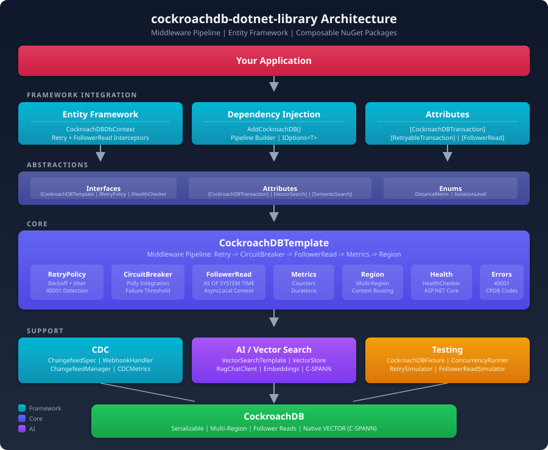

# CockroachDB .NET Library

[](https://github.com/cockroachlabs/cockroachdb-dotnet-library/actions/workflows/ci.yml)
[](https://github.com/cockroachlabs/cockroachdb-dotnet-library/releases)
[](https://dotnet.microsoft.com/)
[](LICENSE)

A production-quality .NET library for [CockroachDB](https://www.cockroachlabs.com/) that provides retry handling, circuit breaker patterns, CDC (Change Data Capture) webhooks, follower reads, multi-region support, AI/vector search (pgvector), RAG pipelines, and concurrency testing -- all through a composable middleware pipeline.

This is the .NET equivalent of the Java [`cockroachdb-spring-boot-starter`](https://github.com/cockroachlabs/cockroachdb-spring-boot-starter), following idiomatic C# and ASP.NET Core patterns.

## Install

Packages are published to this repository's **GitHub Pages NuGet feed** — no token required. Add the source, then install the packages you need:

```xml
<!-- NuGet.config -->
<configuration>
  <packageSources>
    <add key="cockroachlabs" value="https://cockroachlabs.github.io/cockroachdb-dotnet-library/nuget/index.json" />
  </packageSources>
</configuration>
```

```bash
dotnet add package CockroachDB.DotNet.Core --version 1.0.1
```

API reference: https://cockroachlabs.github.io/cockroachdb-dotnet-library/

## Architecture



The library uses a **middleware pipeline** pattern (similar to ASP.NET Core middleware or MediatR behaviors). Each concern -- retry, circuit breaker, metrics, region routing, follower reads -- is a separate middleware step that users compose declaratively.

```
Metrics -> CircuitBreaker -> Retry -> Region -> FollowerRead -> [operation]
```

### NuGet Packages

| Package | Purpose |
|---------|---------|
| `CockroachDB.DotNet.Abstractions` | Interfaces, attributes, configuration models (zero external deps) |
| `CockroachDB.DotNet.Core` | Middleware pipeline, retry engine, circuit breaker, region context, follower reads |
| `CockroachDB.DotNet.EntityFramework` | EF Core interceptors, entity attributes, `DbContext` extensions |
| `CockroachDB.DotNet.Cdc` | Changefeed creation via SQL, webhook listener endpoint |
| `CockroachDB.DotNet.AI` | AI/vector search, RAG pipelines, semantic search, chat integration, pgvector support |
| `CockroachDB.DotNet.Testing` | Testcontainers fixture, concurrency runner, retry/follower-read simulators |
| `CockroachDB.DotNet.Demo` | ASP.NET Core sample app demonstrating all features |

### Dependency Graph

```
Abstractions (zero deps)
    |
  Core (Npgsql, Polly)
    |           |          |
EntityFramework  Cdc        AI (pgvector, RAG)
    |
  Testing (Testcontainers)
    |
   Demo (ASP.NET Core)
```

## Quick Start

### 1. Register Services

```csharp
var builder = WebApplication.CreateBuilder(args);

var connectionString = builder.Configuration.GetConnectionString("CockroachDB")
    ?? "Host=localhost;Port=26257;Database=defaultdb;Username=root;SSL Mode=Disable;";

builder.Services.AddSingleton(NpgsqlDataSource.Create(connectionString));

builder.Services.AddCockroachDB(builder.Configuration, pipeline =>
{
    pipeline.UseMetrics();
    pipeline.UseCircuitBreaker();
    pipeline.UseRetry();
    pipeline.UseRegion();
    pipeline.UseFollowerRead();
});
```

### 2. Use the Template API

```csharp
public class OrderService(ICockroachDBTemplate crdb, AppDbContext db)
{
    public async Task CreateOrderAsync(Order order)
    {
        await crdb.ExecuteAsync(async () =>
        {
            db.Orders.Add(order);
            await db.SaveChangesAsync();
        });
    }

    public async Task<List<Order>> GetOrdersStaleAsync()
    {
        return await crdb.ExecuteFollowerReadAsync(async () =>
            await db.Orders.AsNoTracking().ToListAsync());
    }

    public async Task CreateInRegionAsync(Order order, string region)
    {
        await crdb.InRegion(region).ExecuteAsync(async () =>
        {
            db.Orders.Add(order);
            await db.SaveChangesAsync();
        });
    }
}
```

### 3. EF Core Integration

```csharp
builder.Services.AddDbContext<AppDbContext>(options =>
    options.UseCockroachDB(connectionString));
```

The `CockroachDBCommandInterceptor` automatically:
- Detects `FollowerReadContext` and prepends `SET TRANSACTION AS OF SYSTEM TIME follower_read_timestamp()`
- Detects `RegionContext` and prepends `SET crdb_region = '<region>'`

## Features

### Retry on Serialization Conflicts (SQLSTATE 40001)

CockroachDB uses serializable isolation by default, which can produce `40001` errors under contention. The retry middleware catches these and retries with exponential backoff + jitter.

```csharp
// Via template
await crdb.ExecuteAsync(async () => { /* retried automatically */ });

// Via attribute (on middleware context)
[CockroachDB(MaxRetries = 5, DelayMs = 200)]
```

Configuration in `appsettings.json`:

```json
{
  "CockroachDB": {
    "Retry": {
      "MaxRetries": 3,
      "DelayMs": 100,
      "Multiplier": 2.0,
      "MaxDelayMs": 5000,
      "JitterMs": 50
    }
  }
}
```

### Follower Reads

Read from the nearest replica for lower latency at the cost of slight staleness. Three activation methods:

**1. Ambient Context (EF Core)**
```csharp
using (FollowerReadContext.Scoped())
{
    return await db.Orders.AsNoTracking().ToListAsync();
}
```

**2. Template API**
```csharp
var orders = await crdb.ExecuteFollowerReadAsync(async () =>
    await db.Orders.AsNoTracking().ToListAsync());
```

**3. Attribute**
```csharp
[FollowerRead]
public class StaleReadService { /* ... */ }
```

### Circuit Breaker

Opens the circuit after consecutive failures, preventing cascading failures:

```csharp
pipeline.UseCircuitBreaker();
```

### Multi-Region Support

Route queries to specific CockroachDB regions:

```csharp
// Via template
await crdb.InRegion("us-east1").ExecuteAsync(() => /* ... */);

// Via ambient context
using (RegionContext.Scoped("eu-west1"))
{
    await db.Orders.ToListAsync();
}
```

Entity attributes for multi-region tables:

```csharp
[RegionalByRow]
public class Order
{
    [CrdbRegion]
    public string Region { get; set; } = "";
}

[GlobalTable]
public class Product { /* ... */ }
```

### CDC (Change Data Capture)

Listen for changefeed events via webhooks:

```csharp
// Register CDC
builder.Services.AddCockroachDBCdc();
builder.Services.AddChangefeedHandler<Order, OrderChangefeedHandler>();

// Map webhook endpoint
app.MapCockroachDBChangefeed<Order>("/webhooks/orders");
```

Implement a handler:

```csharp
public class OrderChangefeedHandler : IChangefeedHandler<Order>
{
    public Task HandleAsync(ChangefeedPayload<Order> payload, CancellationToken ct)
    {
        foreach (var evt in payload.Events)
            Console.WriteLine($"Order {evt.After.Id} changed");
        return Task.CompletedTask;
    }
}
```

### Metrics

Built-in metrics recording for transactions, retries, failures, and follower reads:

```csharp
pipeline.UseMetrics();

// Access programmatically
var metrics = serviceProvider.GetRequiredService<ICockroachDBMetrics>();
Console.WriteLine($"Transactions: {metrics.TransactionCount}");
Console.WriteLine($"Retries: {metrics.RetryCount}");
Console.WriteLine($"Follower Reads: {metrics.FollowerReadCount}");
```

### AI / Vector Search (pgvector)

CockroachDB supports pgvector for vector similarity search with C-SPANN distributed indexing. The `CockroachDB.DotNet.AI` package provides a complete AI integration layer.

#### Register AI Services

```csharp
builder.Services.AddCockroachDBAI(builder.Configuration);
builder.Services.AddCockroachDBVectorStore();
builder.Services.AddCockroachDBRagChat();
```

Configuration in `appsettings.json`:

```json
{
  "CockroachDB": {
    "AI": {
      "Enabled": true,
      "VectorSearch": {
        "DefaultMetric": "Cosine",
        "DefaultLimit": 10,
        "DefaultTable": "vector_store",
        "DefaultVectorColumn": "embedding",
        "InitializeSchema": true,
        "DefaultBeamSize": 32
      },
      "Embedding": {
        "Provider": "local",
        "Dimensions": 1536
      },
      "Chat": {
        "MaxContextDocuments": 5,
        "SimilarityThreshold": 0.7,
        "SystemPrompt": "You are a helpful assistant."
      }
    }
  }
}
```

#### Vector Search Template

Direct SQL-level vector search with full control:

```csharp
var template = serviceProvider.GetRequiredService<VectorSearchTemplate>();

// Search for similar vectors
var results = await template.SearchAsync(
    table: "documents",
    embedding: queryVector,
    limit: 10,
    metric: DistanceMetric.Cosine);

// Store an embedding
await template.StoreEmbeddingAsync("documents", "doc-1", embedding);

// Store with metadata (JSONB)
await template.StoreEmbeddingWithMetadataAsync("documents", "doc-1", embedding,
    new Dictionary<string, object?> { ["category"] = "science", ["year"] = 2024 });
```

#### Vector Store (Document-Level API)

Higher-level API for document management with automatic embedding generation:

```csharp
var store = serviceProvider.GetRequiredService<CockroachDBVectorStore>();

// Initialize schema (creates table + vector index)
await store.InitializeSchemaAsync();

// Add documents
await store.AddDocumentsAsync(new[]
{
    new VectorDocument { Id = "1", Text = "CockroachDB is distributed SQL" },
    new VectorDocument { Id = "2", Text = "Vector search uses pgvector" }
});

// Similarity search
var results = await store.SimilaritySearchAsync("distributed database", topK: 5);
```

#### Metadata Filtering

Filter vector search results using JSONB metadata:

```csharp
var filter = new FilterGroup
{
    Logic = FilterLogic.And,
    Expressions =
    [
        new() { Key = "category", Operator = FilterOperator.Eq, Value = "tech" },
        new() { Key = "year", Operator = FilterOperator.Gte, Value = 2023 }
    ]
};

// Generates: metadata->>'category' = 'tech' AND (metadata->>'year')::numeric >= 2023
var sql = FilterExpressionConverter.Convert(filter);
```

Supported operators: `Eq`, `Ne`, `Gt`, `Gte`, `Lt`, `Lte`, `In`, `NotIn`.

#### Distance Metrics

| Metric | pgvector Operator | Use Case |
|--------|-------------------|----------|
| L2 (Euclidean) | `<->` | General purpose, absolute distance |
| Cosine | `<=>` | Text embeddings, direction similarity |
| Inner Product | `<#>` | Pre-normalized vectors, maximum dot product |

CockroachDB's C-SPANN distributed vector indexing supports `beam_size` for accuracy/speed tradeoff:

```csharp
// Higher beam_size = more accurate but slower
await template.SearchAsync("docs", embedding, limit: 10,
    metric: DistanceMetric.Cosine, beamSize: 32);
```

#### RAG (Retrieval-Augmented Generation)

Complete RAG pipeline with provider-agnostic LLM integration:

```csharp
// Implement IChatCompletionProvider for your LLM (OpenAI, Anthropic, etc.)
public class OpenAIChatProvider : IChatCompletionProvider
{
    public async Task<ChatResponse> CompleteAsync(
        IReadOnlyList<ChatMessage> messages, ChatOptions? options, CancellationToken ct)
    {
        // Call your LLM API
    }
}

// Register and use
builder.Services.AddSingleton<IChatCompletionProvider, OpenAIChatProvider>();
builder.Services.AddCockroachDBRagChat();

// The RAG client automatically:
// 1. Generates embedding for the user query
// 2. Searches the vector store for relevant context
// 3. Builds the prompt with system message + context documents + history
// 4. Delegates to IChatCompletionProvider for completion
var chat = serviceProvider.GetRequiredService<IChatClient>();
var response = await chat.CompleteAsync("What is CockroachDB?");
```

#### Attributes

Declarative annotations for vector search behavior:

```csharp
// Mark a method for vector search
[VectorSearch(Table = "products", Metric = DistanceMetric.Cosine, Limit = 5, BeamSize = 32)]
public Task<List<Product>> FindSimilarAsync(float[] queryVector) { /* ... */ }

// Semantic search with metadata filtering
[SemanticSearch(Table = "articles", Filter = "category = :category", MaxDistance = 0.5)]
public Task<List<Article>> SearchAsync(float[] queryVector) { /* ... */ }

// Mark a property as a vector column
public class Document
{
    [VectorColumn(Dimensions = 1536)]
    public float[]? Embedding { get; set; }
}
```

#### AI Metrics

Thread-safe metrics for vector search, embeddings, and chat:

```csharp
var metrics = serviceProvider.GetRequiredService<IAIMetrics>();
Console.WriteLine($"Searches: {metrics.VectorSearchCount}");
Console.WriteLine($"Failures: {metrics.VectorSearchFailureCount}");
Console.WriteLine($"Avg Duration: {metrics.AverageVectorSearchDurationMs}ms");
Console.WriteLine($"Embeddings: {metrics.EmbeddingGenerationCount}");
Console.WriteLine($"Chat Completions: {metrics.ChatCompletionCount}");
```

### Transaction Isolation

```csharp
// Read Committed (relaxed isolation)
await crdb.ExecuteReadCommittedAsync(async () => { /* ... */ });

// Default: Serializable
await crdb.ExecuteAsync(async () => { /* ... */ });
```

### EF Core Migration SQL Generator

The `CockroachDBMigrationsSqlGenerator` extends Npgsql's generator with CockroachDB-specific DDL handling:

```csharp
builder.Services.AddDbContext<AppDbContext>(options =>
    options.UseNpgsql(connectionString)
           .UseCockroachDB());  // Registers migration generator + NoopLock + interceptors
```

Handles:
- **Computed columns** — Enforces `STORED` (CockroachDB doesn't support virtual), emits `GENERATED ALWAYS AS ((expr)::type) STORED`
- **JSON defaults** — Fixes EF Core's empty-string default for JSONB columns to `{}`
- **Serial columns** — Maps `unique_rowid()` correctly for INT8 primary keys

### NoopMigrationsDatabaseLock

CockroachDB lacks PostgreSQL's advisory locks (`pg_advisory_lock`). The `CockroachDBHistoryRepository` provides a no-op lock so EF Core 10+ migrations work:

```csharp
// Automatically registered when UseCockroachDB() is called — no manual config needed
// Migration coordination should happen at the deployment level (single-pod deploy, migration job)
```

### Computed Columns

```csharp
using CockroachDB.DotNet.Abstractions.Attributes;

public class Order
{
    public Guid Id { get; set; }
    public int Price { get; set; }
    public int Quantity { get; set; }

    [CockroachDBComputed("price * quantity")]
    public int Total { get; set; }
}
```

### Migration from efcore.pg.cockroach

```csharp
// Before (old library)
options.UseNpgsql(conn).UseCockroach();

// After (new library — includes migration gen + NoopLock + interceptors)
builder.Services.AddCockroachDB();
options.UseNpgsql(conn).UseCockroachDB();
```

The new library provides everything `efcore.pg.cockroach` did plus: automatic retry on SQLSTATE 40001, circuit breaker (Polly v8), multi-region routing, follower reads, CDC webhooks, vector search, and OpenTelemetry metrics.

## Testing

### Test Harness

The `CockroachDB.DotNet.Testing` package provides utilities for testing CockroachDB-specific behavior without a live cluster.

**Retry Simulator** -- force `40001` serialization errors:

```csharp
var result = await RetrySimulator.SimulateConflictAsync(
    failCount: 2,
    operation: attempt => Task.FromResult($"attempt-{attempt}"));

Assert.Equal(3, result.TotalAttempts);
Assert.True(result.Succeeded);
```

**Follower Read Simulator** -- measure write-to-visible staleness:

```csharp
var result = await FollowerReadSimulator.MeasureStalenessAsync(
    writeOperation: () => WriteToDatabase(),
    followerReadCheck: () => IsVisibleOnFollower(),
    maxWaitMs: 5000);

Assert.True(result.WasVisible);
Console.WriteLine($"Visible after {result.WriteToVisibleMs}ms");
```

**Concurrency Runner** -- stress test under contention:

```csharp
var result = await ConcurrencyRunner.RunAsync(
    threads: 10,
    iterationsPerThread: 100,
    action: () => TransferMoney(from, to, 1.00m));

Assert.Equal(0, result.Failures);
```

**Testcontainers Fixture** -- real CockroachDB in Docker:

```csharp
public class IntegrationTests(CockroachDBFixture fixture)
    : IClassFixture<CockroachDBFixture>
{
    [Fact]
    public async Task RealDatabaseTest()
    {
        await using var db = CreateDbContext(fixture.ConnectionString);
        // ...
    }
}
```

### Running Tests

```bash
dotnet test
```

## Demo App

The `CockroachDB.DotNet.Demo` project is a minimal ASP.NET Core app demonstrating all features:

| Endpoint | Method | Description |
|----------|--------|-------------|
| `/` | GET | Health check / welcome |
| `/health` | GET | ASP.NET Core health check |
| `/orders` | GET | List all orders |
| `/orders` | POST | Create an order (with retry) |
| `/orders/stale` | GET | Follower read via `FollowerReadContext.Scoped()` |
| `/orders/stale/template` | GET | Follower read via `ICockroachDBTemplate` |
| `/webhooks/orders` | POST | CDC webhook endpoint |
| `/ai/init` | POST | Initialize vector store schema |
| `/ai/documents` | POST | Ingest documents into vector store |
| `/ai/documents` | DELETE | Delete documents by ID |
| `/ai/search` | POST | Similarity search (text query) |
| `/ai/chat` | POST | RAG chat (context-aware Q&A) |
| `/ai/metrics` | GET | AI metrics (search counts, durations) |

Run the demo:

```bash
cd src/CockroachDB.DotNet.Demo
dotnet run
```

## Configuration Reference

Full `appsettings.json` configuration:

```json
{
  "ConnectionStrings": {
    "CockroachDB": "Host=localhost;Port=26257;Database=defaultdb;Username=root;SSL Mode=Disable;"
  },
  "CockroachDB": {
    "Retry": {
      "MaxRetries": 3,
      "DelayMs": 100,
      "Multiplier": 2.0,
      "MaxDelayMs": 5000,
      "JitterMs": 50
    },
    "CircuitBreaker": {
      "FailureRatio": 0.5,
      "MinimumThroughput": 10,
      "SamplingDurationSeconds": 30,
      "BreakDurationSeconds": 60
    },
    "Region": {
      "Default": "",
      "Validate": false,
      "Allowed": [],
      "Resolver": "Context",
      "HeaderName": "X-CockroachDB-Region"
    },
    "Metrics": {
      "Enabled": true
    },
    "AI": {
      "Enabled": true,
      "VectorSearch": {
        "DefaultMetric": "Cosine",
        "DefaultLimit": 10,
        "DefaultBeamSize": 0,
        "DefaultTable": "vector_store",
        "DefaultVectorColumn": "embedding",
        "InitializeSchema": false
      },
      "Embedding": {
        "Provider": "local",
        "Dimensions": 1536
      },
      "Chat": {
        "MaxContextDocuments": 5,
        "SimilarityThreshold": 0.7,
        "SystemPrompt": "You are a helpful assistant."
      }
    }
  }
}
```

## Java / .NET Mapping

| Java Concept | .NET Equivalent |
|-------------|-----------------|
| `@CockroachDB` annotation | `[CockroachDB]` attribute |
| `@FollowerRead` annotation | `[FollowerRead]` attribute + `FollowerReadContext` |
| Spring AOP `@Around` | `ICockroachDBMiddleware` pipeline |
| `CockroachDBTemplate` | `ICockroachDBTemplate` |
| `ThreadLocal<String>` | `AsyncLocal<string>` |
| `@ConfigurationProperties` | `IOptions<CockroachDBOptions>` |
| `@AutoConfiguration` | `IServiceCollection.AddCockroachDB()` |
| Micrometer counters | `ICockroachDBMetrics` / `IAIMetrics` |
| `@VectorSearch` annotation | `[VectorSearch]` attribute |
| `@SemanticSearch` annotation | `[SemanticSearch]` attribute |
| `@VectorColumn` annotation | `[VectorColumn]` attribute |
| `VectorSearchTemplate` (JDBC) | `VectorSearchTemplate` (Npgsql) |
| `CockroachDBVectorStore` (Spring AI) | `CockroachDBVectorStore` |
| `CockroachDBFilterExpressionConverter` | `FilterExpressionConverter` |
| `ExecutorService` + `CountDownLatch` | `ConcurrencyRunner` (`Task.WhenAll` + `Barrier`) |
| Testcontainers (Java) | Testcontainers (dotnet) via `CockroachDBFixture` |

## Requirements

- .NET 10+ / C# 13
- CockroachDB v23.1+ (for follower reads and multi-region features)
- CockroachDB v24.3+ (for pgvector / C-SPANN vector indexing)
- Docker (for Testcontainers-based integration tests)

## Cockroach Continuum

Optional surfaces for [Cockroach Continuum](https://www.cockroachlabs.com/docs/continuum), separate from the core pipeline. Clients fall back to an in-memory simulated backend when no API key/endpoint is configured, so code runs without a Continuum organization. The HTTP clients take an injectable `HttpClient` for tests.

```csharp
using CockroachDB.DotNet.Continuum.Cloud;
using CockroachDB.DotNet.Continuum.Mcp;
using CockroachDB.DotNet.Continuum.Aegis;

// --- Cloud control plane ---
var cloud = HttpCloudClient.Create(HttpCloudClient.DefaultBaseUrl, apiKey);
var clusters = await cloud.ListClustersAsync();
await cloud.ConfigureMetricExportAsync(clusterId, MetricExport.Datadog(ddKey, "US1")); // typed builders
// Readiness: ContinuumCloudHealthCheck (IHealthCheck) registered via DI.

// --- Virtual clusters + routing ---
var vm = new VirtualClusterManager(sqlRunner); // ISqlRunner (Npgsql default)
await vm.CreateAsync("analytics");
var cs = VirtualClusterManager.RoutingConnString(baseConnString, "analytics"); // Options=-ccluster=

// --- MCP client (real 2025-06-18 wire protocol) + Aegis over MCP ---
var mcp = HttpMcpClient.Create("https://cockroachlabs.cloud/mcp", token);
var tools = await mcp.ListToolsAsync();
var aegis = new McpAegisClient(mcp, new McpToolNames(Findings: "list_findings")); // discover via ListToolsAsync
var findings = await aegis.GetFindingsAsync();
```

MCP is a public, versioned protocol, so the client speaks the real wire format (initialize handshake, `tools/list`, `tools/call`, SSE + session handling). The Aegis REST API is not yet public, so Aegis is reached read-only **over MCP** with caller-supplied tool names rather than an invented wire protocol.

Also in the `Continuum` package: a standalone **Aegis** client (findings/recommendations + app "exhaust"), **Plenum** storage insights, and **vCluster** workload tagging.

```csharp
// Aegis — simulated by default:
IAegisClient aegis = new SimulatedAegisClient();
await aegis.GetFindingsAsync();

// Plenum — read-only, customer-safe per-table storage insights:
IStorageInsights storage = new StorageInsights(dataSource);

// vCluster — workload tagging / QoS:
using (VirtualClusterContext.Scoped("analytics", WorkloadPriority.Low)) { /* run report */ }
```

## License

MIT
